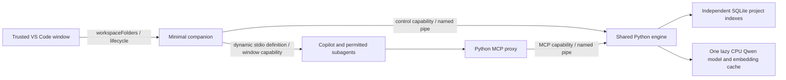

# Architecture

The supported editor integration is a companion extension with a dynamic MCP
server definition provider. Static user MCP configuration cannot reliably supply
the trusted folders belonging to the originating VS Code window. MCP Roots is
not used. The selected API is documented in the
[VS Code MCP extension guide](https://code.visualstudio.com/api/extension-guides/ai/mcp).
Actual parent/child calls were required before embedding work; see the gate record.

## Authority and lifecycle

Each long-lived editor pipe connection owns a session containing independent
control/MCP capability tokens and a workspace generation. Tokens are generated
cryptographically, are never tool arguments or diagnostics, and are passed only
through the stdio process environment. Disconnecting an owner revokes its sessions.
Control commands additionally require the exact originating pipe connection.
Folder replacement revokes old roots before resolving new ones, even if a new
root fails validation. Every source response verifies its generation again before
returning. No global active workspace is shared by windows.

Canonical local paths, a persisted host identifier and directory identity produce
stable 128-bit project identifiers. Separate index directories hold metadata and
SQLite files. A project reference count spans windows. One session is elected to
create its VS Code filesystem watcher; a closed owner relinquishes the lease.
The new owner reconciles the watcher handoff gap. All trusted roots in multi-root
workspaces are eligible, and every result identifies its particular project.

Opening activates a persistent index and queues a full hash reconciliation.
Subsequent saved-file events are debounced and update only affected files.
Directory/ignore changes require discovery. Periodic metadata scans recover
missed events; less frequent full hashing catches equal-stat content changes.
The single background worker rotates projects after bounded batches. Queries
receive the shared inference lock before the next background batch. Closing the
final reference cancels between files/batches and preserves completed commits.
The model unloads after five idle minutes; the engine exits two minutes after
all editor sessions close. No index is deleted just because its folder closes.

## Source and chunks

Discovery uses pathspec ignore rules without requiring a Git repository. Built-in
generated/dependency exclusions are supplemented by nested `.gitignore` and optional
global/per-path rules. Reads are bounded, decode text BOMs, reject binaries and
compare file identity/size/mtime before and after reading. On Windows the final
opened handle's physical path must stay inside its authorized root. Discovery
does not traverse symlinks/junctions, Git history or application storage.

Tree-sitter provides function/class/method/export/decorator boundaries, FastAPI
route aliases, nested composable functions/state, Vue template/script/style spans,
SQL definitions and configuration sections. Large bodies split by child statements
before a token-budget leaf fallback. Unsupported/missing grammars are explicit
structural fallbacks; error-tolerant parses are marked `tree_sitter_partial`.
Qwen's verified local tokenizer sets budgets without loading model weights.
Original bytes, columns and line ranges are retained. Path/line offsets do not
enter the embedding text, allowing identical moved content to reuse embeddings.

## Inference choice

The official [Qwen GGUF model card](https://huggingface.co/Qwen/Qwen3-Embedding-0.6B-GGUF)
documents llama.cpp with last-token pooling. The
[base model reference](https://huggingface.co/Qwen/Qwen3-Embedding-0.6B) specifies
normalization, task instructions for queries, and output dimensions from 32 to 1024.
CodeConverge uses official Q8_0, CPU mmap, explicit EOS tokenization, last pooling,
1024 dimensions and L2 normalization. No neural reranking model is loaded.

The conventional Transformers/SentenceTransformers path was evaluated from its
official usage and dependency/memory requirements. It was not speed-benchmarked on
this machine; no performance ratio is claimed. Q8_0 supplies a verified 639 MB
asset and the measured process fits the 2 GiB target with one native model. The
official Windows CPU wheel for llama-cpp-python 0.3.19 was pinned because this
machine lacks the compiler toolchain needed for newer source-only releases.

The high-level Python embedding wrapper could not batch independent sequences in
this wheel's default context. The implementation uses its public llama.cpp C API
with an explicit multi-sequence context and sequence-pooled outputs. Actual batch
and single-input embeddings were checked for numerical consistency. No library
patches, private VS Code APIs or external inference server are used.

## Storage and retrieval

SQLite WAL/FULL transactions, foreign keys, FTS5 BM25 and sqlite-vec cosine vectors
share each project's database. A file replacement updates chunks, lexical rows
and stale-vector deletion in one transaction. Embeddings are attached only if the
chunk key still matches, preventing a slow inference result from attaching to an
edited chunk. Crash-completed commits survive restart; pending rows resume.

Content/model/configuration-addressed vectors live in a shared bounded SQLite
memoization cache. Index vectors remain independent of memoization eviction.
Configuration fingerprints invalidate only the affected representation when the
engine restarts. Corrupt databases are quarantined before rebuilding derived data.

Retrieval iterates only roots granted to the calling session. BM25 includes
camelCase/snake_case expansion. Exact/prefix symbols include route aliases.
Cosine nearest neighbors are combined with lexical and symbol ranks using RRF
(constant 60), modest exact-definition/path boosts and overlap/hash suppression.
Auto mode can avoid inference for an exact definition. Explicit hybrid mode always
combines available channels; unavailable/incomplete semantic data is labeled.
Path/language filters precede semantic ranking so filtering does not discard a
small unrestricted nearest-neighbor list and silently lose recall.

sqlite-vec's persistent exact scans were chosen over an additional ANN index for
transactional simplicity at the target local-project scale. No claim is made for
million-chunk repositories. Every excerpt is rechecked against current saved
source, bounded by line/character budgets, and carries freshness. Search never
uses cached projects as an implicit fallback.

## Maintenance boundary

MCP can propose rebuild/deletion, but cannot supply user approval. A random,
short-lived nonce binds the exact action, project IDs, window and generation.
The originating extension displays the operation, then sends the decision with
its control capability. A workspace switch, expired nonce, another window or a
replayed decision is rejected. Source files and shared model assets are outside
cache-deletion targets. Automatic LRU cleanup requires explicit user configuration
and can evict only inactive derived indexes.

User instructions and custom agents use the harness's native global locations,
as documented in [VS Code customization migration](https://code.visualstudio.com/docs/agent-customization/migrate-customizations).
Tool access remains subject to the agent's allowlist and host behavior; the
verified Copilot tool-deferral compatibility adjustment is documented separately.
